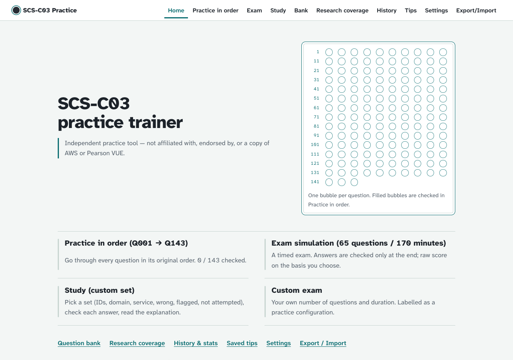

# SCS-C03 Practice Trainer

A free, offline practice app for the **AWS Certified Security – Specialty (SCS-C03)** exam: 143 questions, a timed exam simulation, and study mode with explanations.

**Live demo:** https://phamminhtuan1999.github.io/aws-scs-c03/

> Independent practice tool. Not affiliated with, endorsed by, or a copy of AWS or Pearson VUE.



## Features

- **Practice in order:** go through Q001 → Q143 and pick up where you left off.
- **Exam simulation:** 65 questions in 170 minutes, graded only at the end.
- **Study:** build your own set (by ID, domain, AWS service, wrong last time, flagged, not attempted) and check each answer as you go.
- **Custom exam:** choose the number of questions and the time limit.
- **Explanations:** researched answers with AWS documentation links (explanations are in Vietnamese).
- **Your data stays local:** progress is saved in your browser. No account, no backend, no tracking. Export / import your progress as a file.
- **Accessible:** works on phone, tablet and desktop; keyboard shortcuts; adjustable text size; high-contrast colour schemes.

## Quick start

Requires **Node.js 24** and npm.

```bash
git clone https://github.com/phamminhtuan1999/aws-scs-c03.git
cd aws-scs-c03/app
npm install
npm run dev
```

Then open the URL that Vite prints (usually http://localhost:5173).

## Scripts

Run from the `app/` folder:

| Command | What it does |
| --- | --- |
| `npm run dev` | Start the dev server |
| `npm run build` | Type-check and build the static site into `app/dist` |
| `npm run serve` | Serve the built site on http://localhost:4173 |
| `npm test` | Run unit and UI tests (Vitest) |
| `npm run e2e` | Build, then run end-to-end tests (Playwright, Microsoft Edge) |

The built site must be opened through a web server, not as a `file://` page.

## Deployment

Every push to `main` runs the tests, builds the site and deploys it to **GitHub Pages** (`.github/workflows/pages.yml`). See [docs/GITHUB_PAGES.md](docs/GITHUB_PAGES.md) for first-time setup.

## Project structure

```
app/        React + TypeScript + Vite web app
data/       Question bank, answer keys and images
research/   Independent answer research (verified / ambiguous / unresolved)
tools/      Python scripts that build and validate the data
docs/       Specs and guides
```

## About the answers

Each question has two answers kept separate: the **source key** from the original material, and an independently **researched answer**. Exams are graded on one basis you choose. Of the 143 questions, 119 are verified by research; the rest are marked as ambiguous or unresolved and are never shown as simply "wrong". Scores are raw practice scores, not AWS scaled scores.

Full details on grading, research status, storage and security: [docs/REFERENCE.md](docs/REFERENCE.md).
